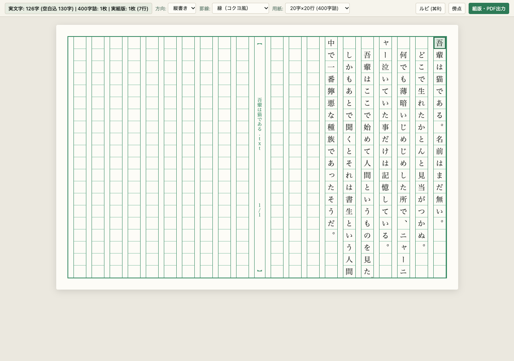

# Genkou Sheet — 原稿用紙エディタ for VS Code

**Genkou Sheet (`genkou-sheet`)** は、Visual Studio Code のエディタ画面自体に**常時「原稿用紙の格子（マス目）」を敷き、縦書き・横書きで直接日本語入力（タイピング・IME変換）ができる**小説・文章執筆用拡張機能です。

文字数・原稿用紙換算カウント、ルビ・傍点、原稿ツリー管理、組版出力などの執筆支援機能を備え、**「指定した執筆用フォルダーだけで機能し、他のプログラミング用プロジェクトには一切干渉しない」** 設計になっています。



画面例の本文は、青空文庫の[夏目漱石「吾輩は猫である」](https://www.aozora.gr.jp/cards/000148/card789.html)より。

---

## 主な特徴 (Features)

1. **原稿用紙のマス目に直接タイピング（縦書き・横書き両対応）**
   * 400字詰め（20字×20行、中央の「柱」・魚尾・ルビ用余白列付き）の原稿用紙グリッドを未入力部分も含めて常時描画します。
   * **縦書き（標準）と横書き**をツールバーからワンクリックで切り替え可能です。
   * 罫線カラーは**緑（コクヨ風）**・**赤（丸善・文豪風）**・**ダークモード**から選択でき、マス目サイズ（文字数×行数）もカスタマイズ可能です。
2. **対象フォルダー限定動作（他プロジェクトへの非干渉）**
   * 拡張機能をインストールしただけでは、普段のプログラミング用プロジェクトの `.txt` や `.md` を乗っ取りません。
   * コマンドパレットから `Genkou: このフォルダーを執筆プロジェクトとして有効化` を実行したフォルダー内でのみ原稿用紙エディタが有効になります。
3. **原稿用紙ルール準拠の組版・執筆補助**
   * **青空文庫形式のルビ・傍点:** `｜漢字《かんじ》` や `《《傍点》》` を解析し、親文字のみマス目を消費してルビ欄（行間）に美しく描画します。
   * **行末の禁則処理（ぶら下げ）:** 20マス目の直後に句読点（`、` `。`）や閉じ括弧（`」` `』`）が来た場合、次行の先頭に送らず20マス目にぶら下げ（同居）表示します。
   * **会話文ハイライト & 自動一字下げ:** 会話文（`「… 」`）の色分け表示と、段落改行（Enter）時の全角スペース自動挿入をサポートします。
4. **プロジェクト管理・出力機能**
   * **リアルタイム文字数・枚数カウント:** 実文字数（ルビ除外）、空白込み文字数、400字詰め換算枚数、実使用行数をステータスバーに常時表示。
   * **原稿ツリー管理:** サイドバーで複数ファイル（章・シーン）の順序並び替えと、プロジェクト全体の文字数・枚数集計を表示。
   * **HTML / PDF 組版出力:** 単一原稿または結合原稿を、印刷・PDF保存用の原稿用紙レイアウトで HTML 出力し、ブラウザから PDF 保存。

---

## クイックスタート (Quick Start)

1. VS Code で執筆用のフォルダーを開きます。
2. コマンドパレット（`Cmd+Shift+P` / `Ctrl+Shift+P`）を開き、以下を実行します：
   ```text
   Genkou: このフォルダーを執筆プロジェクトとして有効化
   ```
3. フォルダー内の `.txt` または `.md` ファイルを開くと、自動的に原稿用紙エディタが起動します。
   * 設定を解除したい場合は `Genkou: 執筆プロジェクト設定を解除` を実行してください。

---

## 設定一覧 (Configuration)

| 設定キー | 説明 | デフォルト値 |
| :--- | :--- | :--- |
| `genkouSheet.enabled` | 現在のワークスペースで原稿用紙モードを有効にするか | `false` |
| `genkouSheet.writingMode` | 書字方向（`vertical-rl`: 縦書き / `horizontal-tb`: 横書き） | `"vertical-rl"` |
| `genkouSheet.gridColor` | 原稿用紙の罫線カラー（`green` / `red` / `dark`） | `"green"` |
| `genkouSheet.charsPerLine` | 1行あたりのマス数（文字数） | `20` |
| `genkouSheet.linesPerPage` | 1ページあたりの行数 | `20` |
| `genkouSheet.highlightDialogue` | 会話文を色分けするか | `true` |
| `genkouSheet.autoIndent` | 改行（Enter）時に行頭へ全角スペースを自動挿入するか | `true` |

---

## ドキュメント・設計仕様 (Documentation)

本プロジェクトの詳細な要件定義および技術仕様は `docs/` 配下に格納されています。

* [要件定義書 (Requirements)](./docs/requirements/requirements.md)
* [アーキテクチャ・技術仕様書 (Architecture)](./docs/specs/architecture.md)
* [原稿用紙組版・UI仕様書 (Grid & Typography)](./docs/specs/grid-and-typography.md)
* [Marketplace・GitHub 公開仕様書 (Publishing)](./docs/specs/publishing.md)
* [AIオーケストレーション開発ガイド (AGENTS.md)](./AGENTS.md)

---

## ライセンス (License)

MIT License
