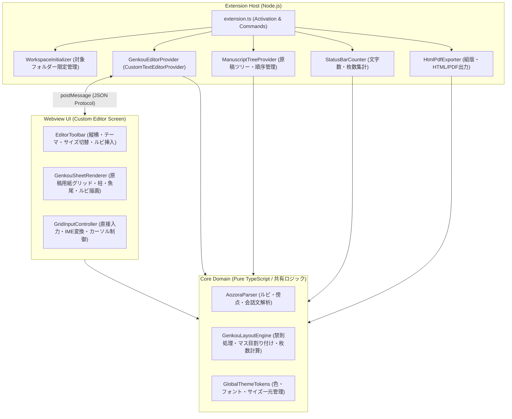

# アーキテクチャ・技術仕様書 (Architecture Specification)

## 1. システム全体構成

本拡張機能は **Extension Host（Node.js / TypeScript）** と **Webview（ブラウザ環境 / TypeScript + CSS Grid/Canvas）** の2層で構成され、クリーンアーキテクチャの原則に従い責務を明確に分離する。



---

## 2. ディレクトリ構造（実装時のターゲット構成）

```text
genkou_sheet/
├── AGENTS.md                        # マルチAIエージェント共通ガイドライン
├── CLAUDE.md                        # Claude Code / AI向けエントリポイント
├── .memory/                         # マルチAIオーケストレーション用永続メモリー
│   ├── project-context.md           # プロジェクト全体コンテキスト・不変ルール
│   ├── decisions.md                 # アーキテクチャ意思決定記録 (ADR)
│   ├── tasks.md                     # タスク分解・進捗・検証基準ボード
│   └── handoff.md                   # エージェント間引き継ぎ・最新状態ログ
├── docs/                            # ドキュメント格納ディレクトリ
│   ├── requirements/
│   │   └── requirements.md          # 要件定義書
│   └── specs/
│       ├── architecture.md          # アーキテクチャ仕様書（本ファイル）
│       ├── grid-and-typography.md   # 原稿用紙組版・UI仕様書
│       └── publishing.md            # Marketplace・GitHub公開仕様書
├── src/
│   ├── extension.ts                 # エントリポイント
│   ├── core/                        # 環境非依存の純粋ロジック（単体テスト対象）
│   │   ├── parser.ts                # 青空文庫ルビ・傍点・会話文パーサー
│   │   ├── layoutEngine.ts          # マス目割り付け・禁則処理・枚数計算エンジン
│   │   ├── counter.ts               # 文字数・原稿用紙換算カウントロジック
│   │   ├── textDiff.ts              # Webview 編集の最小置換範囲計算
│   │   └── theme.ts                 # グローバルテーマ定義（Design Tokens）・設定値の正規化
│   ├── providers/                   # VS Code API 連携層
│   │   ├── genkouEditorProvider.ts  # CustomTextEditorProvider 実装
│   │   ├── manuscriptTreeProvider.ts# 原稿ツリー TreeDataProvider 実装
│   │   └── statusBarProvider.ts     # StatusBarItem 制御
│   ├── services/                    # ワークスペース操作・出力サービス
│   │   ├── workspaceService.ts      # 対象フォルダー初期化・解除 (.genkou.json)
│   │   ├── backupService.ts         # 原稿の自動バックアップ（世代管理）
│   │   └── exportService.ts         # HTML / PDF 組版出力サービス
│   └── webview/                     # Webview フロントエンド実装
│       ├── index.ts                 # Webview エントリ
│       ├── components/              # 疎結合UIコンポーネント群
│       │   ├── Toolbar.ts           # 上部ツールバー
│       │   ├── GenkouPage.ts        # 原稿用紙1ページ（20×20・柱・魚尾）描画
│       │   ├── RubyModal.ts         # ルビ・傍点編集ポップオーバー
│       │   └── InputController.ts   # IME・カーソル・直接入力ハンドラ
│       └── styles/
│           └── globalTheme.css      # CSS Variables による一元管理スタイル
└── test/                            # 自動テスト
    ├── core/
    │   ├── parser.test.ts
    │   └── layoutEngine.test.ts
    └── integration/
```

---

## 3. 対象フォルダー限定の動作制御仕様

他のプロジェクトへの影響をゼロにするため、以下の2段階のガードを設ける。

1. **Workspace 設定による Editor Association 制御:**
   * `package.json` の `contributes.customEditors` では、`priority` を `"option"` に設定する。これにより、拡張機能をインストールしただけでは、どのフォルダーの `.txt` / `.md` も勝手には原稿用紙エディタで開かない。
   * ユーザーが対象フォルダーで `Genkou: このフォルダーを執筆プロジェクトとして有効化` を実行したときのみ、そのワークスペースの `.vscode/settings.json` に以下を書き込む：
     ```json
     {
       "genkouSheet.enabled": true,
       "workbench.editorAssociations": {
         "*.txt": "genkouSheet.editor",
         "*.md": "genkouSheet.editor"
       }
     }
     ```
2. **`.genkou.json` によるプロジェクト設定・原稿順序管理:**
   * 対象フォルダー直下に `.genkou.json` を作成し、原稿ツリーの並び順やデフォルトの用紙設定（色・縦横・字数×行数）を保存する。

---

## 4. Extension Host ⇔ Webview メッセージングプロトコル

型安全な判別共用体（Discriminated Unions）で通信を行う。

### Host → Webview (`HostToWebviewMessage`)
* `INIT_DOCUMENT`: `{ type: 'INIT_DOCUMENT', text: string, config: GenkouConfig, version: number }`
* `DOCUMENT_CHANGED`: `{ type: 'DOCUMENT_CHANGED', text: string, version: number }`（外部変更やUndo/Redo時）
* `EDIT_RESULT`: `{ type: 'EDIT_RESULT', text: string, version: number, accepted: boolean }`（編集の成否と現在の文書）
* `CONFIG_CHANGED`: `{ type: 'CONFIG_CHANGED', config: GenkouConfig }`

### Webview → Host (`WebviewToHostMessage`)
* `READY`: `{ type: 'READY' }`
* `EDIT_TEXT`: `{ type: 'EDIT_TEXT', text: string, version: number }`（version は編集元の文書バージョン。送信は一件ずつ）
* `PRESERVE_CONFLICT`: `{ type: 'PRESERVE_CONFLICT', text: string }`（競合した未保存入力を新規文書に退避）
* `UPDATE_CONFIG`: `{ type: 'UPDATE_CONFIG', partialConfig: Partial<GenkouConfig> }`
* `REQUEST_EXPORT`: `{ type: 'REQUEST_EXPORT', format: 'html' | 'combined' }`

### 通信上の規約
* Webview 側の `text` は常に改行コード LF で扱う。CRLF の文書では Host が送信時に LF へ、受信時に CRLF へ変換する。
* Host は `EDIT_TEXT` の全文と現在の文書を比較し（`core/textDiff.ts`）、変更範囲だけを `WorkspaceEdit` で置換する。
* `UPDATE_CONFIG` は Webview が変更可能なキー（書字方向・罫線色・字数・行数・字下げ・会話文強調）だけを `sanitizeGenkouConfig` で正規化して保存する。フォルダー未オープン時はユーザー設定に保存する。
* ワークスペース設定値は信頼できない入力として扱い、Host・出力 HTML とも `sanitizeGenkouConfig` を通してから使う。

---

## 5. 自動バックアップ

* 対象: 原稿用紙エディタで開いた `file:` スキームの `.txt` / `.md`、および有効化済みフォルダー内の `.txt` / `.md`。
* 保存先: `ExtensionContext.globalStorageUri/backups/<URIのSHA-256先頭32桁>/`。プロジェクトフォルダーにはファイルを作らない。
* タイミング: 最後の変更から 1.5 秒後、保存時、文書を閉じた時、拡張機能の終了時。直前の世代と同じ内容、およびディスク上の保存済み内容と同じテキストは書き込まない（「保存しない」で閉じた際の revert で未保存の世代を上書きしないため。復元直前の退避は例外として必ず書く）。
* 世代: 最新世代の作成から `genkouSheet.backup.intervalMinutes`（既定 5 分）以内の変更は最新世代を上書きし、それを過ぎたら新しい世代を作る。`genkouSheet.backup.maxSnapshots`（既定 50）を超えた古い世代は削除する。書き込みは一時ファイルからの rename で行う。
* 復元: `genkouSheet.restoreBackup` で世代を選び、読み取り専用の差分表示（`genkou-backup:` スキーム）・Undo 可能な置換（置換前の内容を新しい世代として退避）・新規タブへの展開を選べる。
* 差分表示: 左右とも読み取り専用の `genkou-backup:` 文書で開く（左 `/<key>/<作成時刻ms>` がバックアップ、右 `/current/<連番>` が差分を開いた時点の原稿で、メモリ上に保持し閉じたら破棄）。パスを `.txt` / `.md` で終わらせないことで、執筆フォルダーの `workbench.editorAssociations` が適用されず、必ずテキスト差分になる。query に復元先の原稿 URI（`target`）と表示名（`name`）を持つ。
* 差分画面での復元: 差分を開いた際の通知のボタン、またはエディタタイトルの `genkouSheet.applyBackupInDiff`（左側が `genkou-backup:` の差分がアクティブなとき context key `genkouSheet.backupDiffActive` で表示）から、確認ダイアログ後に `target` の原稿を全文置換する。

---

## 6. グローバルテーマ設計 (Global Theme Management)

コンポーネント内でのスタイル直書き（ハードコード）を禁止し、`src/core/theme.ts` および `globalTheme.css` の CSS カスタムプロパティ（Design Tokens）で一元管理する。

| カテゴリ | トークン例 | 説明 |
| :--- | :--- | :--- |
| **Color Palette** | `--genkou-paper-bg`, `--genkou-grid-primary`, `--genkou-grid-sub`, `--genkou-text-main`, `--genkou-text-dialogue`, `--genkou-cursor-bg` | 緑罫線（コクヨ風）、赤罫線（丸善風）、ダークテーマをクラス切替のみで反映 |
| **Typography** | `--genkou-font-family`, `--genkou-cell-font-size`, `--genkou-ruby-font-size` | 游明朝・ヒラギノ明朝・Noto Serif JP 等の明朝体フォールバックと比率定義 |
| **Spacing & Grid** | `--genkou-cell-size`, `--genkou-ruby-gap`, `--genkou-page-padding`, `--genkou-hashira-width` | 1マスの寸法、ルビ欄の幅、中央の柱（魚尾エリア）の寸法 |
| **Radius & Shadow** | `--genkou-border-radius`, `--genkou-page-shadow` | 原稿用紙のドロップシャドウおよびツールバー・モーダルの角丸 |
